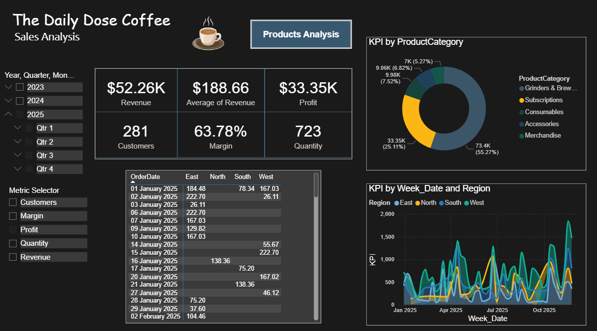
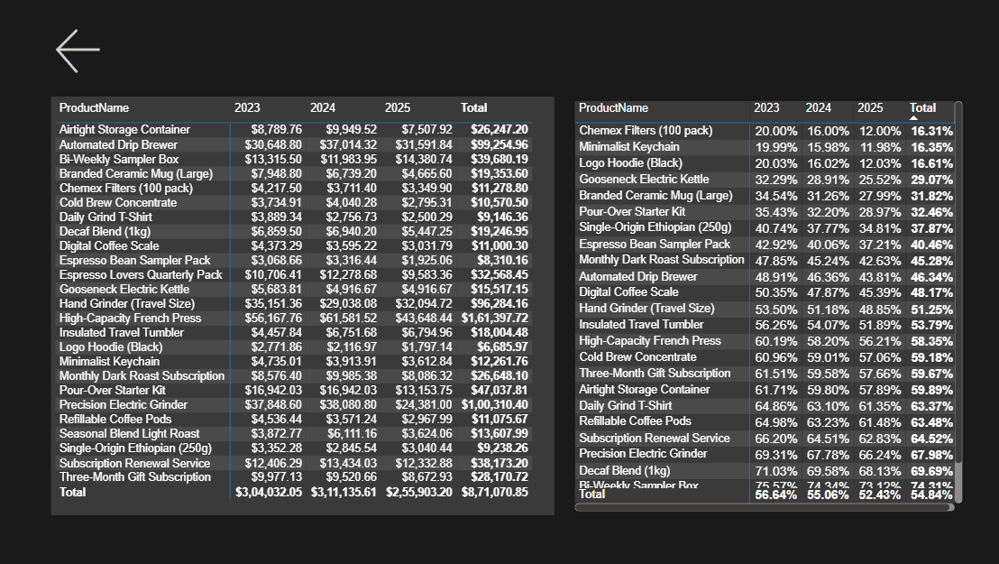

# Coffee Sales Analysis & Pricing Strategy

An end-to-end data analytics project using **Microsoft SQL Server and Power BI** to analyse three years of coffee retail sales data (2023–2025), evaluate product profitability, identify declining gross margins, and develop data-driven pricing recommendations.

---

## Project Overview

This project analyses the sales performance of a fictional coffee retail business, **The Daily Grind**, across 2023, 2024, and 2025.

The objective was to investigate declining profit margins across the product portfolio, understand product and regional performance, and identify products requiring pricing adjustments or potential discontinuation.

SQL Server was used for data extraction, cleaning, transformation, and consolidation, while Power BI was used to develop an interactive dashboard for business analysis.

## Business Problem

Management observed a decline in gross profit margins, potentially caused by rising Cost of Goods Sold (COGS), tariffs, and other operational factors.

The analysis was required to:

- Identify products with Gross Margin Percentage (GMP) below 30% in Q3 2025.
- Analyse year-over-year gross margin performance.
- Evaluate revenue by product, category, and region.
- Identify underperforming products.
- Recommend appropriate pricing adjustments or potential discontinuation.

## Tools & Technologies

| Tool | Purpose |
|---|---|
| Microsoft SQL Server | Data extraction, cleaning, transformation, and querying |
| SQL | UNION ALL, CTEs, JOINs, CASE statements, date functions, calculated columns |
| Microsoft Power BI | Interactive dashboard and visual analytics |
| DAX | KPI calculations and dynamic metric selection |
| CSV | Source data format |

## Dataset

The project uses five source tables:

- `Orders_2023` – 2023 order records
- `Orders_2024` – 2024 order records
- `Orders_2025` – 2025 order records
- `customers` – Customer information and regional details
- `products` – Product names, categories, prices, and base costs

The three yearly order tables were consolidated into a unified dataset for analysis.

*Note: Dataset files are not included in this repository at present.*

## SQL Analysis & Data Preparation

SQL Server was used to prepare a unified dataset from the five source tables.

Key operations included:

1. **Data Consolidation:** Combined the three yearly order tables using `UNION ALL` inside a Common Table Expression (CTE).
2. **Table Joins:** Used `LEFT JOIN` to combine order records with customer and product information.
3. **Missing Revenue Handling:** Used a `CASE WHEN` statement to calculate missing revenue using product price multiplied by quantity.
4. **Data Filtering:** Excluded records with missing Customer IDs from the analysis.
5. **Date Transformation:** Created a weekly aggregation date using `DATEADD()` and `DATEDIFF()`.
6. **Profit Calculation:** Calculated profit using revenue and Cost of Goods Sold (COGS).

The resulting dataset was imported into Power BI for further analysis.

## Power BI Dashboard

The dashboard consists of two analytical pages.

### 1. Sales Performance Dashboard

Provides an overview of business performance through key metrics and interactive visualisations.

**Key features:**
- Revenue, average revenue, profit, customer count, gross margin, and quantity KPIs.
- Year and quarter filters.
- Revenue distribution by product category.
- Weekly performance trends across East, North, South, and West regions.
- Dynamic metric selector to switch between different business metrics.
- Interactive filtering across dashboard visuals.

### 2. Product Profitability Analysis

Provides a deeper view of product-level financial performance across 2023, 2024, and 2025.

**Key features:**
- Product-level revenue comparison across years.
- Year-over-year gross margin comparison.
- Identification of products falling below the 30% gross margin threshold.
- Product profitability assessment to support pricing decisions.

## Key Findings

The dashboard highlights several products with gross margins below the 30% threshold in the Q3 2025 analysis.

| Product | Gross Margin |
|---|---:|
| Minimalist Keychain | 11.98% |
| Chemex Filters (100 pack) | 12.00% |
| Logo Hoodie (Black) | 12.03% |
| Gooseneck Electric Kettle | 25.52% |
| Branded Ceramic Mug (Large) | 27.99% |
| Pour-Over Starter Kit | 28.97% |

The analysis also highlights declining margins across several products over the 2023–2025 period.

## Business Recommendations

Based on the Q3 2025 gross margin analysis, the following pricing interventions are recommended:

| Product | Gross Margin | Recommendation |
|---|---:|---|
| Minimalist Keychain | 11.98% | Significant price increase or discontinuation |
| Chemex Filters (100 pack) | 12.00% | Significant price increase or discontinuation |
| Logo Hoodie (Black) | 12.03% | Significant price increase or discontinuation |
| Gooseneck Electric Kettle | 25.52% | Increase selling price to restore margin above 30% |
| Branded Ceramic Mug (Large) | 27.99% | Review pricing and costs |
| Pour-Over Starter Kit | 28.97% | Review pricing and costs |

**Key Recommendation:**

Prioritise pricing adjustments for the three products with the lowest gross margins. For the remaining products, review selling prices and costs to bring their gross margins above the 30% target.

For products with persistently weak profitability, management should also evaluate opportunities to reduce sourcing or production costs before considering discontinuation.

## Project Files

| Folder / File | Description |
|---|---|
| `SQL/` | SQL queries used for data preparation and analysis |
| `PowerBI/` | Interactive Power BI dashboard |
| `Images/` | Dashboard screenshots and project visuals |
| `Data/` | Source datasets, if redistribution is permitted |

## How to View the Project

1. Browse the dashboard screenshots in the `Images/` folder.
2. Open the `.pbix` file in Microsoft Power BI Desktop to explore the interactive dashboard.
3. Review the SQL script in the `SQL/` folder to understand the data preparation process.

**Requirements:** Microsoft Power BI Desktop and Microsoft SQL Server (for reproducing the SQL workflow).

---

## Author

**Harsh Kumar**

[GitHub Profile](https://github.com/hash1531)

---

*This project demonstrates an end-to-end data analytics workflow, from SQL-based data preparation to interactive Power BI reporting and business-oriented pricing recommendations.*
